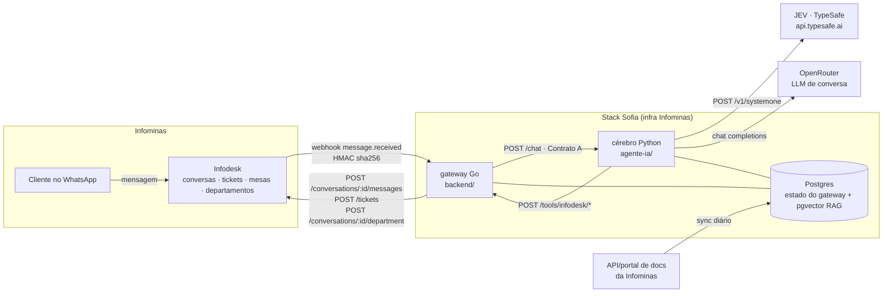

# 00 — Visão geral: Sofia, agente de atendimento da Infominas

> Plano escrito em 2026-10-19. Fonte das regras de negócio: respostas do
> Daniel (arquiteto) na sessão de planejamento + `docs/infodesk/`. O que não
> está nessas duas fontes está em **Pendências** (fim deste arquivo) e NÃO
> deve ser assumido por quem implementa.

## O produto em uma frase

**Sofia** é uma atendente virtual no WhatsApp da Infominas que recebe a
mensagem do cliente final, conversa de forma humana, **classifica** o
problema (JEV, determinístico, com confiança), **roteia** a conversa para o
departamento certo, **abre o ticket** na mesa certa do Infodesk, responde
dúvidas com uma base de conhecimento e **transfere para um atendente humano**
quando o pedido, a mídia, a confiança ou o tom exigem.

## Decisões já tomadas (respostas da sessão)

| # | Decisão | Fonte |
|---|---|---|
| D1 | Manter a arquitetura **gateway Go + cérebro Python** do Zapin; o Infodesk substitui Chatwoot/Evolution; Mongo e SAC saem | resposta 18 |
| D2 | **JEV** (TypeSafe, serviço remoto, rótulo + confiança) classifica categoria, fila e prioridade; o LLM só conversa e cobre os casos de baixa confiança | respostas 1–4 |
| D3 | Categorias virão de **export do Infodesk** (pendente); mapeamento categoria → mesa → departamento → prioridade é **tabela de configuração** validada no boot | respostas 5–7 |
| D4 | Chamado já aberto: **perguntar o número e não duplicar** | resposta 8 |
| D5 | Identificação: o Infodesk tem cadastro de clientes vinculado ao telefone, mas **a API documentada não expõe busca de cliente** (verificado: nenhuma rota em `docs/infodesk/`). Enquanto não houver rota, o bot **pede CPF ou nº de contrato antes de abrir** o ticket; cliente não identificado não abre ticket | respostas 9–10 |
| D6 | Escopo: triagem + ticket + status por número **+ FAQ com RAG**; os documentos vêm de uma **API/portal da Infominas** (detalhes pendentes) | respostas 11, 20 |
| D7 | Persona **Sofia**, pt-BR, informal ("você"), no máximo 1 emoji, saudação por período do dia | resposta 12 |
| D8 | Transferir para humano em: pedido explícito, mídia/áudio, baixa confiança (JEV + LLM), cliente irritado, fora do horário humano (horários pendentes) | resposta 13 |
| D9 | Canal: **só WhatsApp, um número** | resposta 14 |
| D10 | Sem sandbox do Infodesk: testes contra **mock local**; smoke em produção com número de teste | resposta 15 |
| D11 | Produção na **infra da Infominas**; LLM via **OpenRouter** aceito | resposta 16 |
| D12 | Há **histórico de conversas/tickets sem anonimização**: o dataset de evals exige etapa de anonimização antes de versionar | resposta 17 |
| D13 | **GitHub Actions + revisão humana + `main` protegida** | resposta 19 |

## Arquitetura alvo



**Responsabilidades (sem mudar o princípio do Zapin: o LLM nunca é base confiável):**

| Componente | Dono de | Nunca faz |
|---|---|---|
| **gateway Go** (`backend/`) | receber webhook (HMAC, dedup, idade, `organizationId`), fila FIFO + coalescência por conversa, estado da conversa (bot/transferida/encerrada), cache de contato identificado, **cliente HTTP do Infodesk**, **idempotência e registro de tickets**, transferência para humano (inclusive por mídia/falha/pedido explícito), bolhas WhatsApp, alertas, reconciliação por polling | decidir conteúdo de resposta; classificar |
| **cérebro Python** (`agente-ia/`) | grafo da conversa, **classificação (JEV → fallback LLM)**, guardrails de entrada/saída, RAG, tools que o modelo pode chamar (com política de injeção/validação), persona Sofia | falar com o Infodesk diretamente (sempre via `/tools/infodesk/*` do gateway); escolher mesa/prioridade por texto livre |
| **JEV** | rótulo + `probabilities` + `confidence` para intenção, categoria, prioridade, frustração, segurança | gerar texto |
| **LLM** | conversa humanizada, resumo/descrição do ticket (proposta), perguntas de esclarecimento, classificação **só** quando o JEV está abaixo do limiar | autorização, escolha de fila, abertura sem confirmação |

## Fluxo ponta a ponta de uma reclamação

```mermaid
sequenceDiagram
    autonumber
    participant C as Cliente (WhatsApp)
    participant I as Infodesk
    participant G as gateway Go
    participant B as cérebro Python
    participant J as JEV
    participant L as LLM

    C->>I: "minha internet caiu de novo"
    I->>G: webhook message.received (HMAC)
    G-->>I: 200 em <100 ms
    G->>G: dedup (id entrega + message.id), idade, organizationId, fila por conversa, debounce 8 s
    G->>G: conversa transferida/encerrada? mídia sem texto? pediu atendente? → transfere e para
    G->>B: POST /chat {conversation_id, mensagem, telefone, nome, contato_identificado?}
    B->>B: input_guardrail (regex) 
    B->>J: systemone(state=últimas msgs, questions={intencao, categoria, prioridade, frustracao, seguranca})
    J-->>B: {intencao: reclamacao 0.93, categoria: sem_conexao 0.88, prioridade: alta 0.71, frustracao: 0.4, ...}
    B->>B: roteador: confiança ≥ limiar → classificação fixa no estado; senão fallback LLM; senão pergunta de esclarecimento
    B->>B: retrieve (RAG) só se intenção = dúvida
    B->>L: agent (persona Sofia + classificação + contexto) 
    L-->>B: pergunta de identificação (CPF/contrato) se contato não identificado
    B-->>G: reply
    G->>I: POST /conversations/:id/messages (bolhas)
    I->>C: "Boa tarde! Sou a Sofia... pode me passar o CPF ou nº do contrato?"
    C->>I: "123.456.789-09"
    I->>G: webhook
    G->>B: POST /chat
    B->>L: agent → tool informar_identificacao(cpf)
    B->>B: política valida dígito verificador; tool → G /tools/infodesk/contato/identificar (cache 24 h)
    B->>L: agent → tool preparar_abertura_chamado(resumo, descricao)
    B->>G: /tools/infodesk/ticket/preparar (categoria/prioridade INJETADAS do estado; mesa/depto pela tabela; dedup local)
    G-->>B: proposta {titulo, descricao, mesa, departamento, prioridade}
    L-->>B: "Vou registrar: 'Sem conexão desde hoje cedo' na equipe de Suporte. Confirma?"
    C->>I: "sim"
    B->>B: política exige confirmação explícita no turno seguinte + proposta válida (15 min)
    B->>G: /tools/infodesk/ticket/abrir (proposta injetada)
    G->>G: grava ticket 'pendente' (idempotência) 
    G->>I: POST /tickets {deskId, title, description, channel, contactPhone, priorityId?}
    I-->>G: {number: 4821, ...}
    G->>I: POST /conversations/:id/department {departmentId}
    G-->>B: {status: true, numero: 4821}
    L-->>B: "Pronto! Seu chamado é o nº 4821..."
    G->>I: POST /messages
    Note over G,I: humano assume no departamento; conversation.finished → gateway limpa estado
```

**Caminhos alternativos**

- **Dúvida (FAQ)**: intenção `duvida_informacao` → `retrieve` injeta trechos
  da base → resposta com o que a base tem; sem cobertura → oferece abrir
  chamado ou falar com atendente. Nenhuma citação fabricada (guardrail de
  saída do Zapin mantido).
- **Status de chamado**: intenção `status_chamado` → o modelo pede o número →
  tool `consultar_status_chamado(numero)` → `GET /tickets/:number`; o gateway
  só devolve se o ticket pertence ao telefone/CPF da sessão (regra de posse
  depende do schema do ticket — pendência T1; sem schema, só tickets que o
  próprio bot abriu, tabela local).
- **Transferência para humano** (sempre pelo gateway, caminho único como
  `transferencia.go`): pedido explícito (detecção determinística no Go, como
  `PedeAtendente`, + intenção `pedir_atendente` do JEV), mídia/áudio (`body`
  vazio), frustração alta, baixa confiança após esclarecimento, falha do
  cérebro/JEV/disjuntor, fora do horário humano (pendente). Ação:
  mensagem de aviso + `POST /conversations/:id/department {departamento
  humano}` + marca local `transferida` → o gateway ignora webhooks dessa
  conversa até `conversation.finished`.
- **Reconciliação**: job periódico `GET /conversations` para pegar mensagens
  perdidas (webhook best-effort). **Bloqueado** pelo schema (pendência C1).

## O que muda em relação ao Zapin

| Área | Zapin (Azapfy) | Sofia (Infominas) |
|---|---|---|
| Transporte | Chatwoot + Evolution (webhooks `message_created`, labels, equipes, assignee) | **Infodesk** (`message.received`, HMAC `X-Infominas-Signature`, sem labels; estado bot/humano vive no nosso Postgres) |
| Identidade | Gate FSM: login → Mongo → confirmação de e-mail | **Sem login.** Telefone do webhook + CPF/contrato pedido na conversa (validado por código) + cache 24 h; lookup no Infodesk quando houver rota (pendente) |
| Chamados | SAC da Azapfy via `/tools/sac/*` | **Infodesk tickets** via `/tools/infodesk/*`; idempotência e listagem **locais** (a API não lista nem tem chave de idempotência) |
| Classificação | Classificador LLM só para segurança (suporte/off_topic/malicioso) | **JEV** para intenção, categoria, prioridade, frustração e segurança; LLM só abaixo do limiar |
| Roteamento | Nenhum (uma equipe) | Tabela categoria → mesa/departamento/prioridade; transferência de departamento no Infodesk |
| RAG | AzapDocs (Contrato B) → pgvector | Mesmo pipeline; **fonte nova** (API/portal da Infominas, pendente) |
| Persona | Zapin, "Boníssimo dia" 🧡 | **Sofia**, pt-BR informal, 1 emoji, saudação por período |
| Grafo | `entry → input_guardrail → retrieve → agent ⇄ tools → output_guardrail` | `entry → input_guardrail → classificar → retrieve? → agent ⇄ tools → output_guardrail` (nó `classificar` novo; `retrieve` condicional à intenção) |
| Segurança | `tool_policy` injeta telefone/empresa | `tool_policy` injeta telefone, **classificação**, **proposta**, **identificação** — o modelo nunca escolhe mesa, prioridade ou CPF |
| Deploy | VM Azapfy ARM64 ao lado do omni-route | Infra da Infominas (compose genérico; runbook novo) |
| Testes/CI | só `go vet`/`go test` em CI | lint + arquitetura + testes + evals nos dois lados (ver `04-esteira-qualidade.md`) |
| Removido | `internal/chatwoot`, `internal/mongo`, `internal/identity` (gate de login), `internal/sac`, `mock-chatwoot/`, `src/tools/sac_tools.py`, `crm_mocks.py`, `identidade_mock.py`, `login_extractor.py`, `FonteAPIDocumentacao` do AzapDocs, workflow `configure-chatwoot.yml`, `infra/terraform` e ansible específicos da VM Azapfy | — |
| Mantido (refatorado) | `engine` (coalescer, disjuntor, transferência, bolhas), `store` (dois backends), `brain`, `alerta`, `webhook` (receptor), `toolsapi` (padrão), grafo/nós/política/guardrails/RAG/tracing/falhas do Python | — |

## Estrutura de pastas alvo

```
sofia-agente-ia-infominas/
├── CLAUDE.md                     # enxuto; aponta para skills e docs
├── .claude/                      # harness (skills, agents, hooks, settings)
├── docs/
│   ├── infodesk/                 # API do Infodesk (fonte: PDF)
│   ├── plano/                    # este plano (00–06)
│   ├── decisoes/                 # ADRs curtos
│   └── zapin/                    # legado de referência (CLAUDE antigo, laudos)
├── backend/                      # gateway Go (módulo `bot-infominas`)
│   ├── cmd/bot/main.go
│   └── internal/{config,infodesk,webhook,engine,store,contato,toolsapi,brain,alerta,reconciliador}
├── agente-ia/                    # cérebro Python
│   ├── server.py  app.py  pyproject.toml
│   ├── config/taxonomia.yaml     # categorias → mesa/departamento/prioridade (preenchida pelo export)
│   ├── src/{agent,classificacao,tools,rag,security,identity,observability}
│   ├── tests/                    # unit + contrato + e2e com fakes
│   └── evals/                    # datasets anonimizados + runners (classificação e conversa)
├── mock-infodesk/                # harness E2E: finge ser o Infodesk (stdlib Python)
├── contratos/                    # JSON de exemplo do Contrato A e de /tools/infodesk/* (testados dos dois lados)
├── docker-compose.yml  .env.example  deploy/
└── .github/workflows/{ci.yml,evals-noturnos.yml,deploy.yml}
```

## Pendências / decisões em aberto (resumo; detalhe em cada doc)

| ID | Pendência | Bloqueia | Dono |
|---|---|---|---|
| P1 | Export das categorias do Infodesk + lista de mesas/departamentos + mapeamento | `config/taxonomia.yaml` real (etapas de classificação rodam com taxonomia **placeholder** marcada) | Daniel / Infominas |
| P2 | Rota de busca de cliente por telefone no Infodesk (não documentada) | identificação automática; até lá, CPF/contrato na conversa | Infominas |
| P3 | Schemas de resposta (`POST /tickets`, `GET /tickets/:number`, `GET /conversations`, `GET /conversations/:id`, payloads de `conversation.*`) — `docs/infodesk/07` | tipagem forte no Go, posse de ticket, reconciliador | Infominas |
| P4 | `priorityId`: lista de UUIDs de prioridade | envio de prioridade ao Infodesk (até lá vai no texto) | Infominas |
| P5 | Como detectar que um humano assumiu a conversa sem o bot ter transferido (C3) | risco de bot falar por cima do humano | Infominas |
| P6 | API/portal de documentos da Infominas para o RAG (URL, auth, formato) | fonte do RAG (pipeline fica pronto com fonte local) | Daniel |
| P7 | Horário de atendimento humano e mensagem fora do horário | regra de transferência "fora do horário" | Infominas |
| P8 | Acesso ao JEV (chave `TYPESAFE_API_KEY`, limites de rate, plano) e desempenho em pt-BR | thresholds reais; evals de classificação com JEV real | Daniel |
| P9 | Export do histórico de conversas/tickets + aprovação do processo de anonimização | dataset real de evals | Daniel / Infominas |
| P10 | Infra da Infominas: host, Docker disponível?, domínio público HTTPS para o webhook, quem opera | deploy | Infominas |
| P11 | Departamento humano padrão (destino de toda transferência) e se existe fila "triagem" para baixa confiança | config de transferência | Infominas |
