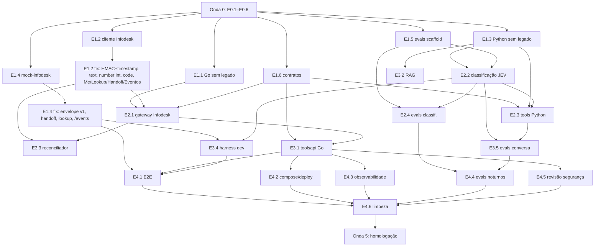

# 03 — Plano em etapas (ondas paralelizáveis)

Regras de leitura:

- **Onda** = conjunto de etapas que podem rodar **ao mesmo tempo**, cada uma
  numa sessão/worktree própria, **sem tocar nos mesmos arquivos** ("zona").
  Entre ondas a dependência é explícita: a onda N+1 só começa quando as
  etapas de que depende estão **mergeadas na `main`**.
- Cada etapa tem um **ID** (`E<onda>.<n>`) usado no nome da branch
  (`onda2/e2.3-tools-python`), no commit (`feat(tools): ... [E2.3]`) e no PR.
- **Critério de pronto** é verificável por comando ou por diff; se o agente
  não consegue provar, a etapa não está pronta.
- Estimativa: **P** (≤ meia sessão), **M** (uma sessão), **G** (uma sessão
  longa ou duas; dividir se passar disso).
- Subagentes e skills referem-se a `.claude/agents/<nome>.md` e
  `.claude/skills/<nome>/SKILL.md`. Todo agente carrega sempre `CLAUDE.md`
  (automático) e a skill `ambiente-testes` quando precisa rodar algo.
- Pendências (`P1`…`P11`) estão em `00-visao-geral.md`. Etapa que depende de
  pendência aberta implementa a **hipótese de trabalho** de forma
  configurável e deixa `// TODO(P<n>)` no código.

Ordem de execução por sessão: ler `CLAUDE.md` → ler esta etapa → ler as
skills listadas → ler os arquivos da zona → implementar → rodar
`scripts/verificar.sh` → abrir PR com o template → pedir revisão
(`revisor`).

> **Revisão 2026-10-20 — API Infodesk v1 (2026-10-19).** `docs/infodesk/`
> foi reescrito a partir do PDF oficial de 25 páginas e respondeu as
> pendências **P2** (`GET /contacts/lookup?phone=`), **P3** (schemas de
> ticket/conversa/eventos) e **P5** (`handledBy` + `conversation.assigned`).
> As etapas da onda 1 já mergeadas (E1.2, E1.4; e por tabela E1.1, E1.6)
> foram escritas sobre o guia antigo e ganharam uma **nota de quebra** na
> própria linha; o ajuste é um PR de correção pequeno em cada uma, **antes**
> de a onda 2 começar (E2.1 depende dele). Nenhuma onda foi reordenada. O que
> continua sendo decisão da Infominas está referenciado pelo item do
> `docs/infodesk/07` e **não** foi decidido aqui.

---

## Onda 0 — Fundação do repositório (sequencial, uma sessão: `refatorador`)

Sem esta onda os hooks de `.claude/settings.json` não têm ferramentas para
rodar. É a única onda que pode tocar em arquivos de todo o repositório.

| ID | Etapa | Est. | Skills |
|---|---|---|---|
| E0.1 | **Tooling Python**: criar `agente-ia/pyproject.toml` com `[tool.ruff]` (line-length 100, `select = ["E","F","I","B","UP","S","N","PL"]`, excluir `evals/bruto`), `[tool.mypy]` (`python_version = "3.12"`, `strict = true` para `src/classificacao`, `src/tools`, `src/identity`; `ignore_missing_imports`), `[tool.pytest.ini_options]` (markers `rede`, `jev`, `llm_real`, `e2e`; `addopts = "-m 'not rede and not jev and not llm_real and not e2e'"`), `[tool.importlinter]` (contratos da seção 04). `requirements-dev.txt`: ruff, mypy, import-linter, pytest-cov, types-PyYAML. `scripts/verificar.sh` com modos `--rapido` (ruff + mypy + pytest unit) e `--completo` (+ go, contrato, e2e com mock). Funciona em Git Bash/Linux. | M | refatorar-modulo, ambiente-testes |
| E0.2 | **Tooling Go**: `backend/.golangci.yml` (errcheck, govet, staticcheck, unused, gosec, revive, depguard com lista de pacotes proibidos: `bot-azapfy/*`, `go.mongodb.org/*`), `gofmt` no verificar, `go test -race -cover`. Instruções de instalação do golangci-lint em `ambiente-testes`. | P | ambiente-testes |
| E0.3 | **CI**: `.github/workflows/ci.yml` (jobs: `lint-python`, `lint-go`, `arquitetura`, `test-python`, `test-go` (com Postgres service para `PG_TEST_URL`), `contratos`, `evals-pr`); `evals-noturnos.yml` (cron 03:00 BRT: `jev`, `llm_real`, juiz) com secrets `TYPESAFE_API_KEY`, `OPENROUTER_API_KEY`; `deploy.yml` passa a `workflow_dispatch` apenas (P10) e `configure-chatwoot.yml` é removido; branch protection documentada em `04`. | M | ambiente-testes |
| E0.4 | **Testes de arquitetura v0**: `agente-ia/tests/test_arquitetura.py` (roda `lint-imports`; varre `src/` e `backend/` por termos do domínio antigo `azapfy|zapin|chatwoot|mongo|sac_|azapers|zprs|zpf-` **menos** os caminhos listados em `docs/plano/legado-permitido.txt` — a lista nasce cobrindo tudo e **cada onda a encolhe**); `backend/internal/arquitetura_test.go` (via `go list -deps`: `engine` não importa `toolsapi`; `infodesk` não importa `engine`/`store`; ninguém importa `chatwoot|mongo|sac|identity` após E1.1). | M | refatorar-modulo |
| E0.5 | **Legado para `docs/zapin/`**: mover `arquitetura-bloco-a-*.md`, `laudo-*.md`, `plano-migracao-pgvector.md`, `contrato-b-*`, `memory.md`, `task.md`, `agente-ia/plano_de_execucao.md` e o `CLAUDE.md` antigo (já em `docs/zapin/CLAUDE-legado.md`); README raiz reescrito (3 parágrafos: o que é, como rodar, onde está o plano). | P | refatorar-modulo |
| E0.6 | **Renomear módulo Go** `bot-azapfy` → `bot-infominas` (`go.mod` + todos os imports), `name:` do compose → `sofia-bot`, imagens `sofia-bot:{brain,gateway}-<tag>`. `go build ./... && go test ./...` verdes. | P | refatorar-modulo |

**Pronto da onda 0**: `scripts/verificar.sh --rapido` e `--completo` rodam
localmente e no CI (verde, com a allowlist de legado cheia); hooks de
`.claude/settings.json` executam sem erro de "comando não encontrado".

---

## Onda 1 — Tirar o domínio antigo, entrar o Infodesk (paralelo: 5 sessões)

| ID | Etapa | Zona (só estes caminhos) | Depende | Est. | Subagente | Skills |
|---|---|---|---|---|---|---|
| E1.1 | **Go sem Chatwoot/Mongo/SAC/gate**: apagar `internal/{chatwoot,mongo,sac,identity}`; `engine` passa a depender de uma interface `Transporte` (`EnviarMensagem`, `TransferirDepartamento`, `LerConversa`) e de um `inbound` neutro (`{ConversationID string, Telefone, Nome, Texto, MsgID, TemMidia bool, CriadoEm}`); remover gate (sem login): a engine encaminha direto ao cérebro; `store`: `conversation_id` vira `string`, apagar `gate_state`/`identities`, manter `processed_events` e `falhas` (prefixo `SOF-`); `config`: remover vars Chatwoot/Mongo/SAC, adicionar `INFODESK_*` (lista em `01`, seção B) e `DEPARTAMENTO_HUMANO_PADRAO`; `alerta`: renomear `zapin_*` → `sofia_*`; testes: fakes `fakeTransporte`, manter cobertura de coalescer/disjuntor/transferência/whatsapp. `main.go` compila com `infodesk` ainda ausente usando um `transporteNulo` (log). **Nota (API v1, 2026-10-19):** a interface `Transporte` nasceu com `TransferirDepartamento`; a E2.1 a troca por `Handoff(ctx, convID, deptID, note)` (ADR 0007) e renomeia o parâmetro `body` → `texto` em `EnviarMensagem` — sem PR próprio, vai dentro da E2.1. | `backend/**` exceto `backend/internal/infodesk/**` | E0.* | G | refatorador | refatorar-modulo, infodesk-api |
| E1.2 | **Cliente Go do Infodesk** `internal/infodesk`: `Client` (Options: BaseURL, APIKey, HTTP, Now, cache TTL), métodos da seção B do `01` (`EnviarMensagem`, `TransferirDepartamento`, `Atribuir`, `Encerrar`, `Mesas`, `Departamentos`, `Atendentes`, `CriarTicket`, `Ticket`, `ResponderTicket`, `Conversas`, `Conversa`), tipos (`Ticket{Number string; Bruto}` tolerante a número/string), `*HTTPError{Status, Mensagem}` com `Transitorio()` (429/5xx/rede), higienização de corpo de erro (PII), `VerificarAssinatura(secret, raw, header)` (`sha256=` + tempo constante), tipos do webhook (`Evento`, `MensagemRecebida`). Testes com `httptest` cobrindo cada rota, 401/403/404/429, Retry-After, assinatura válida/inválida. Nenhum retry em `CriarTicket`. **Nota de quebra (API v1, 2026-10-19) — PR de correção `fix(infodesk): … [E1.2]` antes da E2.1:** (a) `VerificarAssinatura(secret, timestamp, raw, header)`: HMAC sobre `"<X-Infominas-Timestamp>.<raw>"` e recusa de `\|now − ts\| > 5 min` com `Now` injetável (`docs/infodesk/05`); (b) `EnviarMensagem` envia `{ "text": … }`, não `{ "body": … }`; (c) `Ticket.Number` vira **`int`** e `Ticket` ganha `Status{ID, Name, IsOpen, IsClose, IsCanceled}`, `IsClosed`, `ConversationID`, `ContactPhone`, `Requester` (o resto segue em `Bruto`); (d) `HTTPError` ganha `Code` (`UNAUTHORIZED`, `FORBIDDEN`, `NOT_FOUND`, `VALIDATION_ERROR`, `INVALID_REFERENCE`, `CONFLICT`, `RATE_LIMITED`, `WHATSAPP_WINDOW_CLOSED`, `INTERNAL_ERROR`) e `Transitorio()` decide por ele (`docs/infodesk/06`); (e) métodos novos da seção B do `01`: `Me()`, `Lookup(phone)`, `Handoff(convID, Handoff{DepartmentID, UserID, Note})`, `Eventos(after, limit)`, `Mesa(id)`, `Catalogo(deskID)`, `CriarTicketDaConversa`, `ListarTickets(filtro)`, `VincularSolicitante`, `NotaInterna`; `Conversas` passa a receber `FiltroConversas`; (f) tipos do webhook: `Evento{ID, Seq, Event, CreatedAt, OrganizationID, Data}` com `Data.Conversation{HandledBy, BotActive, Channel, Contact{GroupJid}}` e `Data.Message{Type, Attachment, Internal}`; paginação `{data, nextCursor}` e `{data, nextAfter, hasMore}`. Testes: assinatura com timestamp válido/expirado/futuro, `text` no corpo, `number` inteiro, `code` → `Transitorio()`. | `backend/internal/infodesk/**` | E0.6 | M | implementador-go | infodesk-api, nova-tool |
| E1.3 | **Python sem SAC/Mongo/AzapDocs, persona Sofia**: apagar `src/tools/{sac_tools,crm_mocks,identidade_mock}.py`, `src/identity/login_extractor.py`, `FonteAPIDocumentacao` e `sync --fonte api`, endpoint `/extract-login`, testes correspondentes; `get_default_tools()` vazio temporariamente (teste `test_default_tools` ajustado); `prompts.py`: `SYSTEM_PROMPT_AGENTE` reescrito para a **Sofia** (seções: persona, formato WhatsApp, com quem fala, identidade imutável, sobre a Infominas (placeholder P6), base de conhecimento, anti-injection, ferramentas, fluxo de chamado em 2 fases com identificação, fora de escopo), `RESPOSTA_*` no tom novo; `_periodo_do_dia` mantido; `falhas.py` prefixo `SOF-`; `config.py`: remover `sac_*`, `docs_api_*`, adicionar `infodesk_tools_base_url/token/timeout`, `jev_*`, `ident_*`; `state.py`: adicionar `classificacao`, `identificacao` (persistem), remover `proposta_chamado` da docstring do Mongo; `app.py` (Chainlit) pede telefone + nome; `.env.example` dos dois níveis atualizado. `pytest` verde. | `agente-ia/**` exceto `agente-ia/evals/**`, `agente-ia/config/**`, `agente-ia/src/classificacao/**` | E0.* | G | refatorador | refatorar-modulo |
| E1.4 | **`mock-infodesk/`** (stdlib Python, sem pip, como o `mock-chatwoot`): servidor em `:9000` que (a) expõe a REST do Infodesk usada por nós (`/integration/v1/{desks,users,departments,tickets,tickets/:n,tickets/:n/reply,conversations,conversations/:id,conversations/:id/{messages,assign,department,finish}}`) com estado em memória e erros realistas (401 sem chave, 403 por escopo configurável, 404, 429 opcional, 4xx de validação sem `deskId`); (b) emite webhooks assinados (`X-Infominas-Signature`) para `GATEWAY_WEBHOOK_URL` quando o "cliente" escreve na UI; (c) UI mínima (telefone, nome, enviar texto, enviar "áudio" = body vazio, ver bolhas, ver tickets abertos, ver departamento atual). `README.md` com como rodar e variáveis. Teste `mock_infodesk_test.py` (stdlib `unittest`). **Nota de quebra (API v1, 2026-10-19) — PR de correção `fix(mock-infodesk): … [E1.4]` antes da E2.1:** (a) webhooks assinados com `X-Infominas-Timestamp` e `HMAC(secret, "<ts>.<raw>")`, mais `X-Infominas-Delivery` (novo a cada reentrega) e envelope `{id: "evt_…", seq, event, createdAt, organizationId, data}` com `data.conversation` **completo** (`handledBy: "EXTERNAL_BOT"`, `botActive`, `channel`, `contact.groupJid: null`, `sessionStartedAt`) e `data.message` (`type`, `attachment`, `internal`) exatamente como `docs/infodesk/05`; (b) `POST /conversations/:id/messages` aceita **`text`** (e `internal: true`), devolve `201 {conversationId, messages:[…]}`; `body` → `400 VALIDATION_ERROR`; (c) `number` **sempre inteiro** (remover `MOCK_NUMBER_COMO_STRING`); objeto `ticket` como `docs/infodesk/03` (`status` objeto com `isOpen/isClose/isCanceled`, `conversationId`, `requester`); (d) erros com `code` (`docs/infodesk/06`); (e) rotas novas: `GET /me`, `GET /desks/:id` (com `priorities`, `statuses`, `stages`, `catalogItems`), `GET /catalog?deskId=`, `GET /contacts/lookup?phone=`, `POST /conversations/:id/ticket` (`period`, `finish`), `POST /conversations/:id/link-ticket`, `POST /conversations/:id/handoff` (emite `conversation.handoff`, muda `handledBy` para `QUEUE`/`AGENT`), `POST /conversations/:id/requester`, `GET /tickets?phone=&status=&cursor=`, `POST /tickets/:number/notes`, `GET /events?after=&limit=` (`{data, nextAfter, hasMore}`, mesmo envelope); (f) UI ganha "**atendente assume**" (emite `conversation.assigned` e `handledBy: AGENT`) e "reentregar último evento" (mesmo `id`, novo `X-Infominas-Delivery`); opção `MOCK_SEM_REENTREGA` para o E2E de dedup; (g) `dados.json` ganha mesas com nomes do `docs/infodesk/09` e prioridades por mesa. | `mock-infodesk/**`, `scripts/start-all.sh`, `scripts/stop-all.sh` | E0.* | M | implementador-python | infodesk-api, ambiente-testes |
| E1.5 | **Scaffolding de evals**: `agente-ia/evals/` com `README.md`, formatos (seção "Dataset" do `02`), `anonimizar.py` (CLI: entrada CSV/JSON bruto em `evals/bruto/` [gitignored] → JSONL anonimizado + relatório do que foi substituído; regex CPF/CNPJ/telefone/e-mail/CEP/placa, lista de nomes próprios via `config/nomes.txt` opcional), `classificacao/sintetico.jsonl` v0 (≥ 15 casos por categoria do placeholder, com pt-BR coloquial e erros de digitação), `conversa/TEMPLATE.yaml`, `relatorio.py` (métricas da seção "Dataset"), runners `python -m evals.classificacao --fonte sintetico|historico [--jev|--llm]` e `python -m evals.conversa` (esqueleto que importa `build_graph`; marca `xfail` até E2.2/E2.3), `config/taxonomia.yaml` placeholder (formato do `02`). | `agente-ia/evals/**`, `agente-ia/config/**`, `.gitignore` | E0.1 | M | escritor-evals | evals-agente, jev-classificacao |
| E1.6 | **Contratos** `contratos/`: `contrato-a/{chat-request,chat-response}.json`, `tools-infodesk/<endpoint>/{request,ok,erro-<motivo>}.json` exatamente como a seção A do `01`; `README.md` explicando que os testes Go (`toolsapi`) e Python (`infodesk_tools`) carregam esses arquivos; ADR `docs/decisoes/0006-contratos-versionados.md`. **Nota (API v1, 2026-10-19):** chaves e `motivo`s **não mudam**; só texto: `_notas.md` e `contratos/README.md` citam P2/P3/T1/T3 como "sem rota" — atualizar para "respondido em 2026-10-19 (`docs/infodesk/07`)", `contato.forma` ganha o valor `"telefone"`, `observacao` de `listar` passa a "abertos no Infodesk + abertos por aqui". Vai no PR da E3.1 (zona `contratos/**` compartilhada com `implementador-tool`). | `contratos/**`, `docs/decisoes/0006-*.md` | — | P | implementador-tool | nova-tool |

**Pronto da onda 1**: `grep -ri "chatwoot\|mongo\|azapfy" backend/ agente-ia/src` retorna só o que está em `legado-permitido.txt` (que encolheu para ≤ 10 linhas); `go test ./...` e `pytest` verdes; `mock-infodesk` sobe e recebe/emite; `python -m evals.classificacao --fonte sintetico --llm` roda (resultado não importa ainda).

---

## Onda 2 — Núcleo: transporte Infodesk, classificação, tools Python (paralelo: 4 sessões)

| ID | Etapa | Zona | Depende | Est. | Subagente | Skills |
|---|---|---|---|---|---|---|
| E2.1 | **Gateway recebe e responde pelo Infodesk**: `internal/webhook` reescrito para o formato Infodesk v1 (`docs/infodesk/05`): HMAC obrigatório quando `INFODESK_WEBHOOK_SECRET` definido, **com `X-Infominas-Timestamp` e janela de 5 min** (`WEBHOOK_JANELA`, `Now` injetável; fora da janela = `401` + alerta `webhook_timestamp_fora_da_janela`); `200` imediato; dedup pelo **`id` do evento** (`evt_…`) e por `data.message.id`; `organizationId` conferido com `GET /me` do boot; maior `seq` persistido (`eventos_cursor`); **filtro de turno**: só `message.received` com `sender == CLIENT` **e** `conversation.handledBy == EXTERNAL_BOT` **e** `channel == WHATSAPP` **e** `contact.groupJid == null` chega ao cérebro — o resto só atualiza `conversas.handled_by` e loga (`07` N5); **`conversation.assigned`** (ou qualquer evento com `handledBy != EXTERNAL_BOT`) → `conversas.estado = transferida` + métrica `humano_assumiu_sem_handoff`, sem rebaixar estado por evento reentregue mais velho que `updated_at` (`07` W9); `conversation.handoff` → confirma `transferida`; `conversation.finished` → `encerrarEpisodio` (idempotente); `conversation.started` → só log; `ticket.*` → `tickets.status_infodesk`/`encerrado`; `message.sent` com `senderName == INFODESK_NOME_CHAVE` ignorado; `ping` → `200`. `engine` ligado ao `infodesk.Client` (satisfaz `Transporte`, agora com `Handoff`): **caminho único de transferência = `Handoff(DEPARTAMENTO_HUMANO_PADRAO, note por código)`** (ADR 0007) + estado `transferida` (ignora webhooks dela até `finished`), mensagem de aviso **antes** do handoff; mídia (`message.type != TEXT` ou `attachment != null`; a legenda/rótulo `"[imagem]"` que vem na outra mensagem é texto e **não** dispara sozinha) → transfere com aviso; pedido explícito (regex pt-BR) → transfere; `acoes` do `ChatResponse` executadas (`transferir`); `classificacao` gravada; **`Lookup(phone)` no primeiro turno do episódio** → `contatos` (`origem = lookup`) e `contato{forma: "telefone"}` no Contrato A (ADR 0004 revisado; `IDENT_EXIGIR_CPF`, `IDENT_LOOKUP_AMBIGUO`); `GET /me` no boot (escopos mínimos, `handlesConversations`); `store`: tabelas `conversas` (com `handled_by`, `ticket_number`, `sessao_iniciada_em`, `ultima_resposta_em`), `contatos` (com `origem`, `requester_id`), `tickets` (`numero` int, `status_infodesk`, `encerrado`, `reconciliado`), `eventos_cursor`, `processed_events` por `event_id`, nos **dois backends** + `store_test.go` (inclusive migração `delivery_id` → `event_id`); `brain.ChatRequest` com `nome_contato`, `contato`, `estado_conversa`; `main.go` wiring completo. Testes: `engineCompleta` com `fakeInfodesk`, cenários: rajada vira um turno, mídia transfere (duas mensagens → um handoff), conversa transferida fica muda, **atendente assume (`conversation.assigned`) → bot cala sem handoff**, evento com `handledBy: AGENT` reentregue depois de `finished` não reabre, `finished` limpa, falha definitiva do cérebro faz handoff e alerta, HMAC inválido = 401, timestamp > 5 min = 401, mesmo `id` com `X-Infominas-Delivery` novo = no-op, lookup com 1 solicitante dispensa CPF, lookup vazio pede CPF. | `backend/internal/{webhook,engine,store,config,brain,alerta}/**`, `backend/cmd/**` | E1.1, **E1.2 corrigida** (nota de quebra), E1.6 | G | implementador-go | infodesk-api, nova-tool, ambiente-testes |
| E2.2 | **Classificação JEV no cérebro**: `src/classificacao/{jev.py,perguntas.py,taxonomia.py,roteador.py,fallback_llm.py,tipos.py}` conforme `02` (SDK `typesafe-sdk` com `AsyncTypeSafeClient`, timeout 2 s, `RetryPolicy(max_retries=2)`, modelo pinado, fail-soft; `Classificacao` dataclass; `estado_para_jev()` que monta a transcrição mascarando CPF); nó `classificar` no grafo entre `input_guardrail` e `retrieve` (`retrieve` só se intenção ∈ {duvida_informacao, outro}); guardrail de input usa `malicioso`/`fora_de_escopo` do JEV em vez do classificador LLM (regex mantida); `state.classificacao` pegajosa; system prompt recebe bloco "Classificação" e "Identificação"; `ChatResponse.classificacao` e `acoes` (`transferir` por frustração/confiança/pedido); `POST /classificar`; `tools_node` ganha gancho `efeito_pos_tool(nome, resultado, state)` importado de `src/tools/efeitos.py` (default: no-op) para E2.3 preencher. Testes com `FakeJEV` (respostas scriptadas por pergunta) cobrindo cada linha da tabela de limiares, fail-soft, pegajosidade, retrieve condicional. | `agente-ia/src/{classificacao,agent,security}/**` exceto `src/agent/tool_policy.py`; `agente-ia/server.py`; `agente-ia/tests/{test_classificacao*,test_graph*,test_guardrails*,test_server*}.py` | E1.3, E1.5 | G | implementador-python | jev-classificacao, evals-agente |
| E2.3 | **Tools Python do Infodesk**: `src/tools/infodesk_tools.py` com as 6 tools da seção A do `01` (docstrings = instruções ao LLM, `_post` igual ao padrão do Zapin com `X-Tools-Token`, chave de idempotência calculada no `abrir`), `src/tools/efeitos.py` (carimba proposta no `preparar`, consome no `abrir`, grava `identificacao` no `informar_identificacao`), `src/identity/cpf.py` (validação DV + máscara) e `contrato.py`, `src/agent/tool_policy.py` reescrito (`POLITICAS` das 6 tools, resolvers `classificacao_da_sessao`, `identificacao_da_sessao`, validadores `cpf`, `contrato`, `numero`, `motivo`; precondições `exigir_identificado`, `exigir_categoria`, `exigir_proposta_confirmada` com `CONFIRMACOES_EXPLICITAS` da Sofia), `get_default_tools()` = as 6. Testes: política (cada recusa), tools com `httpx` monkeypatchado devolvendo os JSON de `contratos/`, e2e de 2 turnos (preparar → "sim" → abrir) com LLM scriptado. | `agente-ia/src/tools/**`, `agente-ia/src/identity/**`, `agente-ia/src/agent/tool_policy.py`, `agente-ia/tests/{test_tool_policy,test_infodesk_tools,test_cpf,test_e2e_*}.py` | E1.3, E1.6, E2.2 (gancho `efeitos`) | G | implementador-tool | nova-tool, infodesk-api |
| E2.4 | **Evals de classificação v1**: runner usa `src.classificacao.classificar()` real contra o JEV (`-m jev`, precisa `TYPESAFE_API_KEY`) e contra o fallback LLM; relatório de calibração; comparação de janelas de contexto (1/3/6/10 msgs); dataset sintético ampliado para ≥ 150; `evals/README.md` com como interpretar. Critério: relatório gerado em `evals/relatorios/<data>.md` (gitignored, exemplo commitado). | `agente-ia/evals/**` | E2.2 | M | escritor-evals | evals-agente, jev-classificacao |

**Pronto da onda 2**: `scripts/start-all.sh` sobe cérebro + gateway +
mock-infodesk e uma conversa pela UI do mock chega ao LLM e volta como bolhas
(tools ainda recusam no gateway porque `/tools/infodesk/*` não existe — a
resposta de recusa é tratada graciosamente); `pytest` e `go test` verdes;
`legado-permitido.txt` ≤ 5 linhas.

---

## Onda 3 — Tools no gateway, RAG, harness (paralelo: 4 sessões)

| ID | Etapa | Zona | Depende | Est. | Subagente | Skills |
|---|---|---|---|---|---|---|
| E3.1 | **`/tools/infodesk/*` no gateway**: `internal/toolsapi` reescrito (6 handlers da seção A do `01`, `auth` por `X-Tools-Token`, `decode` 64 KiB, convenção `{status,erro,motivo}`); `internal/taxonomia` (carrega `config/taxonomia.yaml`, valida contra `infodesk.Mesas()/Mesa(id)/Departamentos()` no boot, `Resolver(categoria) → {deskID, catalogItemID?, departmentID, priorityID}` com **prioridade e catálogo resolvidos por mesa** — `02`); `abrir` = `POST /conversations/:id/ticket` (`period: session`, `finish: TICKET_FINISH_CONVERSA` default `false` — `07` C6) com `VincularSolicitante` antes quando houver `requester_id`, idempotência pela tabela `tickets` (insert-before-POST, unique, `pendente`→`aberto`/`falha`) e **reconciliação de `pendente` por `ListarTickets(phone, open)`** casando `conversationId` (ADR 0005 revisado; `TICKET_PENDENTE_TTL`); handoff pós-ticket (`TRANSFERIR_APOS_TICKET`); dedup de `preparar` (`chamado_aberto` local + `GET /tickets?phone=&status=open`); posse em `consultar` por código (tabela local → `conversationId` → telefone do ticket → `requester_id`), `status_ticket = status.name`; `listar` = Infodesk por `phone` ∪ local; `identificar` (hash+sal, mascarado, TTL; preserva `requester_id` do lookup); `transferir` pelo caminho único da engine (**handoff**, `note` por código). Atualiza `contratos/**` só em texto (nota da E1.6). Testes: `httptest` + `fakeInfodesk` + SQLite; **testes de contrato** carregando `contratos/tools-infodesk/**`; casos: "POST sem resposta → listagem acha pelo `conversationId` → sucesso sem segundo POST", "POST sem resposta → listagem não acha → `infodesk_indisponivel` + handoff + `pendente` → reconciliador marca `falha` após TTL", "segundo abrir com a mesma chave não duplica", "`VALIDATION_ERROR` vira alerta de configuração sem PII no log", "prioridade sem UUID na mesa → `priorityId` omitido + alerta". | `backend/internal/{toolsapi,taxonomia}/**`, `backend/cmd/bot/main.go` (só o wiring do toolsapi), `contratos/**` (só `_notas.md`/`README.md`/`observacao`) | E2.1, E1.6 | G | implementador-tool | nova-tool, infodesk-api |
| E3.2 | **RAG com fonte da Infominas**: `src/rag/fonte.py` ganha `FonteAPIInfominas` (**stub** configurável até P6: interface igual à `FonteDocumentacao`, erro claro "DOCS_API_* não configurado"); `FonteDocsLocais` aponta para `agente-ia/docs/base/*.md` (3 docs placeholder sobre serviços genéricos de provedor, marcados `placeholder`); `COLLECTION_NAME = "infominas_kb"`; `retrieve` já condicional (E2.2); `sync`/`ingest`/`consultar` renomeados nos logs; remover `verificar.py` se Chroma for descontinuado (decisão: **manter Chroma só para dev**). | `agente-ia/src/rag/**`, `agente-ia/docs/base/**`, `agente-ia/tests/test_{rag,fonte,sync,consultar}*.py` | E1.3 | M | implementador-python | refatorar-modulo |
| E3.3 | **Reconciliador** `internal/reconciliador` (`docs/infodesk/05`, seção 5.5): no boot e a cada `RECONCILIA_INTERVALO` (60 s), `Eventos(after = eventos_cursor.ultimo_seq, limit 500)` → cada envelope entra no **mesmo handler do webhook** (mesmo dedup por `id`, mesmo filtro de turno, mesma fila por conversa); cursor avança só depois de processar a página; pagina enquanto `hasMore`; sem cursor na primeira execução: `after = maior seq visto` ou, sem nenhum, descarta eventos com `createdAt < now − RECONCILIA_RETROATIVO` (1 h). Também: (a) reconcilia `tickets.status == pendente` via `ListarTickets(phone, open)` por `conversationId` até `TICKET_PENDENTE_TTL` → `aberto` ou `falha` + alerta (ADR 0005 revisado); (b) **vigia** `BOT_TIMEOUT_HANDOFF` (5 min): conversa `handled_by == EXTERNAL_BOT` com última mensagem `CLIENT` sem resposta nossa → handoff com nota de erro + alerta (`07` N1, hipótese configurável). **Nasce ligado** (`RECONCILIA_ATIVO=true`); `403 FORBIDDEN` no feed (chave sem `events:read`) → alerta de configuração e o loop segue só com (a)/(b). Testes: `fakeInfodesk` com feed paginado, evento já visto pelo webhook = no-op, evento perdido pelo webhook vira turno, cursor não avança em falha, `pendente` reconciliado/`falha`, vigia dispara uma vez. | `backend/internal/reconciliador/**`, `backend/internal/store/**` (só `eventos_cursor` se a E2.1 não criou) | E2.1, E1.2 corrigida (`Eventos`) | M | implementador-go | infodesk-api |
| E3.4 | **Harness de dev**: `app.py` (Chainlit) simula o Contrato A completo (telefone, nome, contato identificado opcional, mostra `classificacao` e `acoes` de cada turno); `scripts/start-all.sh` sobe mock-infodesk + gateway + cérebro com `.env` de dev; `docs/plano/ambiente-dev.md` curto. | `agente-ia/app.py`, `agente-ia/tests/test_app.py`, `scripts/**` | E2.2, E1.4 | P | implementador-python | ambiente-testes |
| E3.5 | **Evals de conversa**: ≥ 30 cenários `evals/conversa/*.yaml` (reclamação simples; dúvida com RAG; status com número; status sem posse; pedido de atendente; áudio; cliente irritado; baixa confiança → esclarecimento → categoria; categoria pegajosa; proposta expirada; "esse" não confirma; CPF inválido; já tem chamado aberto; prompt injection direta; injeção via RAG; fora de escopo; horário) com LLM scriptado + `FakeJEV`; runner integra ao `pytest -m evals_pr`; relatório. | `agente-ia/evals/**` | E2.2, E2.3 | M | escritor-evals | evals-agente |
| E3.6 | **Correções da engine após E3.1 e E3.3** (itens das revisões dos PRs 18/19 fora das zonas daquelas etapas): (1) **handoff não confirmado** — o handoff que falha depois das tentativas da engine grava a marca `handoffs_pendentes` no store (dois backends) e o vigia do reconciliador o repete com backoff exponencial (30 s → `RECONCILIA_BACKOFF_MAX`) e alerta até confirmar; a marca some no sucesso, em `conversation.handoff`, `finished`, humano conduzindo ou episódio novo (`01` B); (2) **notas por origem** — `motivosDaNota` ganha `vigia` ("sem resposta da Sofia em N min"), `ticket_pendente` ("chamado possivelmente criado, confira no Desk antes de abrir outro") e `ticket_aberto` ("chamado #N aberto"), e o `toolsapi` passa a usar essas origens; (3) **4xx definitivo do POST de ticket** grava `falha` no store (`FalharTicket`) em vez do marcador em memória; o retry segue sem POST nem listagem, também após reinício; (4) **configuração única** — `RECONCILIA_*`, `BOT_TIMEOUT_HANDOFF`, `TICKET_PENDENTE_TTL` e as variáveis da E3.1 (`TICKET_FINISH_CONVERSA`, `TICKET_RODAPE`, `TRANSFERIR_APOS_TICKET`, `TICKET_DEDUP_JANELA`, `DEDUP_CONSULTA_INFODESK`, `IDENT_CONTRATO_RE`, `IDENT_HASH_SAL`, `STRICT_TAXONOMIA`, `TAXONOMIA_PATH`) passam para `internal/config` com default e validação (valor inválido derruba o boot), entram no `.env.example`, e `reconciliador`/`toolsapi` deixam de ler o ambiente; `IDENT_HASH_SAL` vazio avisa no boot. Testes: handoff que falha fica marcado e o vigia repete até confirmar, marca limpa por evento, uma nota por origem, 4xx persiste `falha` sem POST, config com defaults e valores inválidos. | `backend/internal/{engine,store,config,toolsapi,reconciliador}/**`, `backend/cmd/bot/main.go`, `.env.example`, `docs/plano/03-etapas.md` (só esta linha) | E2.1, E3.1, E3.3 | M | implementador-go | infodesk-api |
| E3.7 | **CPF fora do histórico e prazos alinhados** (itens das revisões do PR 25): (1) **PII**: nenhuma mensagem entra no estado do grafo — nem no checkpoint, nem no trace — com CPF/contrato em claro: o redutor de `messages` e um envoltório do checkpointer (`src/agent/pii.py`) mascaram o texto da `HumanMessage` (CPF) e os args `cpf`/`contrato` de `AIMessage.tool_calls` (e o espelho cru do provedor) com a máscara de `src/identity`; o valor em claro vive só num cofre em memória durante o turno (o LLM lê o CPF digitado, a tool o recebe completo) e é descartado no fim dele; `tool_exec_args` (DEBUG) e `agent_tool_calls` (INFO) não logam valores; (2) **prazos**: defaults `BRAIN_TURNO_PRAZO=70s`, `BRAIN_TIMEOUT=80s`, `DEBOUNCE_TETO=20s` e `TURNO_TETO=105s` (`INFODESK_TOOLS_TIMEOUT` segue 30 s) e regras de ordem validadas no boot: `TURNO_TETO >= DEBOUNCE_TETO + BRAIN_TIMEOUT` (gateway, `internal/config` — o teto conta desde a primeira mensagem da rajada) e `BRAIN_TIMEOUT > BRAIN_TURNO_PRAZO > INFODESK_TOOLS_TIMEOUT + folga do JEV` (cérebro: `build_graph` chama `validar_prazos`, que também confere `BRAIN_TIMEOUT`/`TURNO_TETO` quando o ambiente os traz); o retry de 2 s/5 s da engine só cabe quando a rajada foi curta; (3) **docs**: linhas A2/A4 do `01` descrevem `identificacao` como `{forma, valor_mascarado}`, `TODO(E2.3)` de `contratos/tools-infodesk/**/_notas.md` resolvido, `IDENT_EXIGIR_CPF`/`IDENT_CONTRATO_RE` no `agente-ia/.env.example`. Testes: turno de `informar_identificacao` com checkpointer em memória sem CPF em claro no checkpoint, nos args gravados nem nos logs (e a tool recebe o valor), prazos com valores bons e ruins nos dois lados. | `agente-ia/src/agent/**` (exceto `tool_policy.py`, `prompts.py`), `agente-ia/src/config.py`, `agente-ia/tests/test_{graph,nodes,pii,config}*.py`, `backend/internal/config/**`, `.env.example`/`backend/.env.example`/`agente-ia/.env.example` (só as linhas de prazos e `IDENT_*`), `docs/plano/01-ferramentas.md` (A2, A4), `docs/plano/03-etapas.md` (só esta linha) | E2.2, E2.3, E3.6 | M | implementador-python | nova-tool |
| E3.8 | **Guardrail de saída e lote de tool calls** (os dois bugs de produto dos `xfail` da E3.5): (1) `afirmacoes_de_acao` não trata como afirmação de ação a construção de incerteza/condição com "se" na mesma oração ("não consegui confirmar **se** o chamado foi registrado"), para que a resposta honesta depois de um timeout em `abrir_chamado` não seja trocada por `RESPOSTA_ACAO_SEM_FERRAMENTA`; "abri o chamado" sem tool segue barrado, inclusive com "se" em outra oração; (2) `make_tools_node` aplica a política de cada tool call do lote sobre o estado **já atualizado** pelos efeitos das anteriores: duas `abrir_chamado` na mesma mensagem fazem um POST (a 2ª é recusada por falta de proposta). Testes nos dois sentidos para as frases do guardrail e LLM scriptado com abertura duplicada no lote; `conversa-061` e `conversa-062` perdem o `xfail` sem mudar as esperas. | `agente-ia/src/security/output_guardrails.py`, `agente-ia/src/agent/nodes.py`, `agente-ia/tests/test_{guardrails,nodes,graph}*.py`, `agente-ia/evals/conversa/abrir-{incerto-frase-natural-nao-e-trocada,paralelo-posta-uma-vez}.yaml` (só o `xfail`), `docs/plano/03-etapas.md` (só esta linha) | E3.5, E3.7 | P | implementador-python | evals-agente |

**Pronto da onda 3**: pela UI do mock-infodesk, um cliente abre um ticket de
ponta a ponta (lookup identifica **ou** pede CPF → proposta → "sim" → ticket
aparece no mock vinculado à conversa → handoff com nota interna visível no
mock); "atendente assume" na UI do mock cala a Sofia; um evento só no feed
(`GET /events`) vira turno pelo reconciliador; `python -m evals.conversa`
≥ 30 cenários verdes; `go test ./... -race` verde com Postgres no CI.

---

## Onda 4 — Integração, operação e revisão (paralelo: 4 sessões + revisão)

| ID | Etapa | Zona | Depende | Est. | Subagente | Skills |
|---|---|---|---|---|---|---|
| E4.1 | **E2E automatizado**: `backend/internal/e2e/` (build tag `e2e`) sobe mock-infodesk + gateway + cérebro falso (ou real com `OPENROUTER_API_KEY`) e roda 7 cenários (ticket pela conversa + handoff, transferência por áudio (duas mensagens), pedido de atendente, dedup de reentrega (mesmo `id`, `X-Infominas-Delivery` novo), HMAC inválido, timestamp fora da janela de 5 min, evento só no feed `GET /events` recuperado pelo reconciliador); `scripts/verificar.sh --completo` inclui. | `backend/internal/e2e/**`, `scripts/verificar.sh` | E3.1, E3.4 | M | implementador-go | ambiente-testes |
| E4.2 | **Compose e deploy genérico**: `docker-compose.yml` (pgvector, brain, gateway; volume `config/`), `.env.example` final (tabela de variáveis com obrigatórias), Dockerfiles revisados (sem AzapDocs; `typesafe-sdk`), `deploy/README.md` para infra da Infominas (P10: requisitos — Docker, domínio HTTPS para `/webhook`, secrets), `deploy.yml` só `workflow_dispatch`; remover `infra/terraform` e ansible específicos (manter `infra/README.md` dizendo o que falta). | `docker-compose*.yml`, `.env.example`, `agente-ia/Dockerfile`, `backend/Dockerfile`, `deploy/**`, `infra/**`, `.github/workflows/deploy.yml` | E3.1 | M | implementador-go | ambiente-testes |
| E4.3 | **Observabilidade**: logs estruturados com nomes novos (`chat_request`, `classificacao`, `tool_exec`, `ticket_aberto`, `transferencia`, `sofia_alerta`), Langfuse com tags `intencao`/`categoria`/`origem`, métrica de `jev_indisponivel`, `GET /health` do gateway informa cache de referência carregado e taxonomia válida; `docs/plano/operacao.md` (o que olhar quando algo quebra). | `agente-ia/src/observability/**`, `agente-ia/server.py` (logs), `backend/internal/alerta/**`, `backend/cmd/bot/main.go` (health), `docs/plano/operacao.md` | E3.1 | P | implementador-python | ambiente-testes |
| E4.4 | **Evals noturnos**: `evals-noturnos.yml` roda `-m jev` (classificação real) e `evals/conversa/juiz` (LLM real + juiz com rubrica); publica relatório como artefato e comenta no último PR mergeado se regressão > 2 pts. | `.github/workflows/evals-noturnos.yml`, `agente-ia/evals/juiz/**` | E2.4, E3.5 | P | escritor-evals | evals-agente |
| E4.5 | **Revisão de segurança**: rodar `/security-review` e checklist OWASP LLM Top 10 (`revisar-pr`, seção segurança) sobre `main`; verificar: nenhum argumento de escopo no schema do LLM, CPF nunca em log/prompt em claro, HMAC em tempo constante, idempotência provada por teste, mensagens de erro do Infodesk não chegam ao cliente, `output_guardrail` barra "abri o chamado" sem tool. Resultado em `docs/decisoes/0008-revisao-seguranca-v1.md` (0007 passou a ser o ADR do handoff) com achados e PRs de correção. | leitura; correções em PRs separados | onda 3 | M | revisor | revisar-pr |
| E4.6 | **Limpeza final**: `legado-permitido.txt` vazio (teste de arquitetura sem exceções), `docs/zapin/` só com os docs de referência, `README.md` final, `CLAUDE.md` revisado contra o estado real. | `docs/**`, `README.md`, `CLAUDE.md`, `docs/plano/legado-permitido.txt` | todas | P | refatorador | refatorar-modulo |

---

## Onda 5 — Homologação (depende das pendências; sequencial com a Infominas)

| ID | Etapa | Pendência | Critério de pronto |
|---|---|---|---|
| E5.1 | Taxonomia real: preencher `config/taxonomia.yaml` com o export (P1) e UUIDs de prioridade (P4); remover `placeholder: true`; evals de categoria deixam de ser `xfail` | P1, P4 | boot do gateway valida 100 % das mesas/departamentos; `python -m evals.classificacao --fonte sintetico --jev` ≥ metas do `02` |
| E5.2 | Dataset histórico: `anonimizar.py` sobre o export (P9), rotulagem, calibração dos `JEV_LIMIAR_*`; ADR com os valores escolhidos e as curvas | P9, P8 | `historico.jsonl` ≥ 500 casos; ECE ≤ 0.08; limiares versionados |
| E5.3 | Identificação: o lookup já entra na E2.1 (P2 respondido). Aqui fica a **decisão de negócio** `07` N3: valor final de `IDENT_EXIGIR_CPF` em produção e se a Sofia **cadastra** quem o lookup não acha (`POST /requesters`, escopo `contacts:write`; hoje fora da v1); se sim, vira tool nova (`01`, candidata A8) com ADR | N3 (07), P11 | decisão registrada; evals "telefone conhecido não pede CPF" e "desconhecido pede CPF" verdes com o valor escolhido |
| E5.4 | Reconciliador já nasce ligado (E3.3; P3 respondido). Aqui: **validar em produção** contra o Desk real — `GET /events` com a chave real (escopo `events:read`), `seq` monotônico, reentrega manual pela tela "Entregas" não duplica turno; ajustar `RECONCILIA_INTERVALO`/`RECONCILIA_RETROATIVO`; confirmar `07` W8 (eventos das nossas próprias chamadas) e W9 (estado em reentrega) | W8, W9 (07) | 1 h em produção sem duplicata nem turno perdido; `07` W8/W9 marcados RESPONDIDO |
| E5.7 | **Decisões de negócio do ticket** (`07`): `finish` após ticket e encerrar conversa (C6), fechar chamado pela Sofia (T6), campos exigidos no `POST` por mesa (T10), herança de vínculos em `/conversations/:id/ticket` (T11), conversa que já tem `ticketNumber` (T12), departamentos de chat (D6) e timeout do Desk para bot sem resposta (N1) — cada resposta vira valor de config (`TICKET_FINISH_CONVERSA`, `TRANSFERIR_APOS_TICKET`, `DEPARTAMENTO_HUMANO_PADRAO`, `BOT_TIMEOUT_HANDOFF`) + atualização do `07` | C6, T6, T10, T11, T12, D6, N1 | configs sem `TODO(P…)` abertos; `07` sem item `ABERTO` nessas linhas |
| E5.5 | Horário humano e mensagem fora do horário (P7); departamento/mesa de triagem (P11) | P7, P11 | config + eval de conversa "fora do horário" |
| E5.6 | Smoke em produção (D10): número de teste da Infominas, roteiro de 8 cenários, checklist em `docs/plano/homologacao.md`; alertas chegando no canal do responsável | P10 | checklist assinado |

---

## Mapa de dependências

**O que mudou no mapa em 2026-10-20 (API v1):** E1.2 e E1.4 ganharam um PR
de correção cada (`E1.2 fix`, `E1.4 fix`) que passa a ser o pré-requisito
real de E2.1/E3.3 e de E3.4/E4.1; E3.3 depende também de E1.2 (`Eventos`) e
deixou de depender de pendência externa (nasce ligado); E5.3 e E5.4 viraram
validação/decisão em vez de implementação; E5.7 (decisões de negócio do
ticket) é nova. Nenhuma onda mudou de ordem.

## Divisão de trabalho por subagente (resumo)

| Subagente | Etapas |
|---|---|
| `refatorador` | E0.1–E0.6, E1.1, E1.3, E4.6 |
| `implementador-go` | E1.2, E2.1, E3.3, E4.1, E4.2 |
| `implementador-python` | E1.4, E2.2, E3.2, E3.4, E4.3 |
| `implementador-tool` | E1.6, E2.3, E3.1 |
| `escritor-evals` | E1.5, E2.4, E3.5, E4.4 |
| `revisor` | revisão de **todo** PR + E4.5 |
